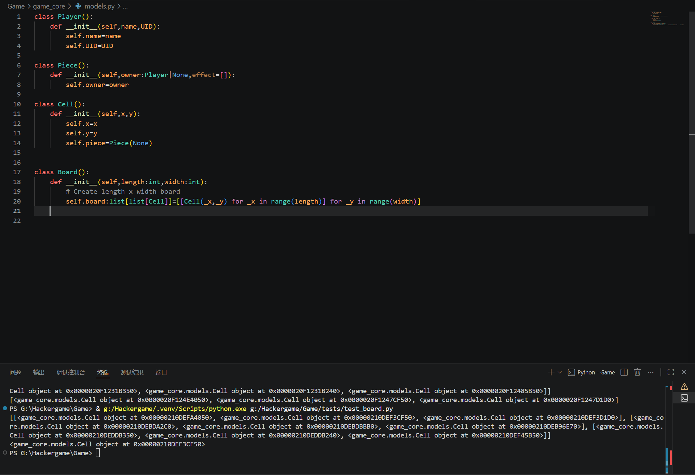
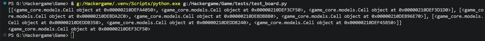

# Day1
# start making Board
Firstly,I would like to start writing the classes.The class is the first of the program understand the Game
The class will be in game/models.py which responsible to the data type/structure,it should include piece/cell/board in this stage

due to the class reason(the Piece requires Player as the ower),I have to put Player class earlier.

trying to check if the Board class is working well,python raise 
```
PS G:\Hackergame\Game> & g:/Hackergame/.venv/Scripts/python.exe g:/Hackergame/Game/tests/test_board.py
Traceback (most recent call last):
  File "g:\Hackergame\Game\tests\test_board.py", line 1, in <module>
    from game_core.models import Board
ModuleNotFoundError: No module named 'game_core'
```
after doing some research,find the solution is adding pyproject.toml to let the python find the correct root folder of the project.After added the file and `pip install -e .`,it works.



Then I am going to make the methon to allowed the other code to access the board,I'm going to make these methon in this stage
```
get_cell
get_piece
remove_piece
place_piece
```